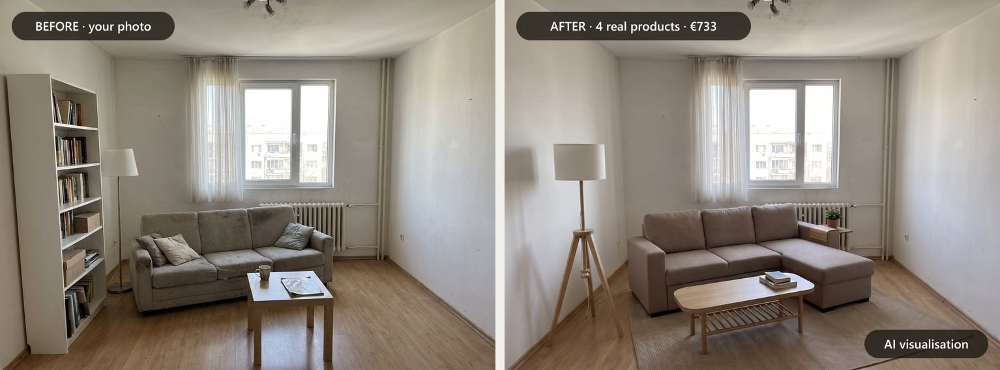
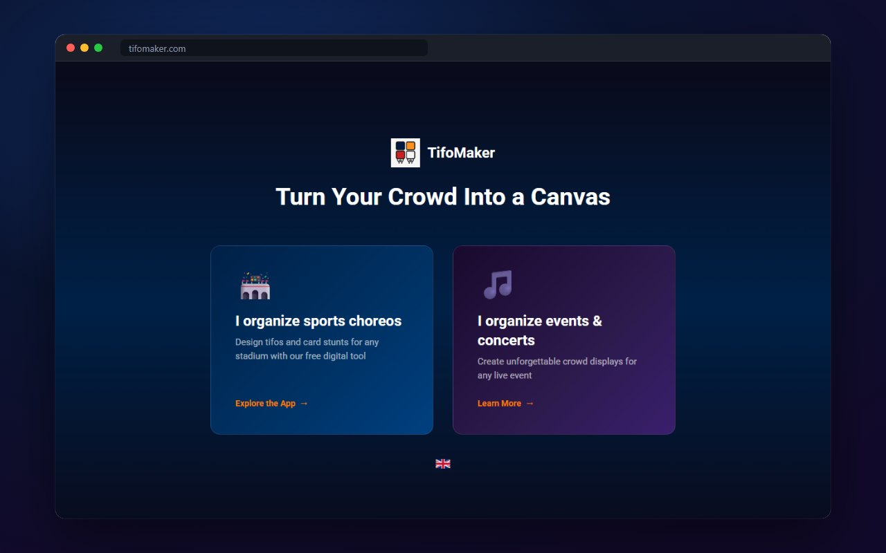
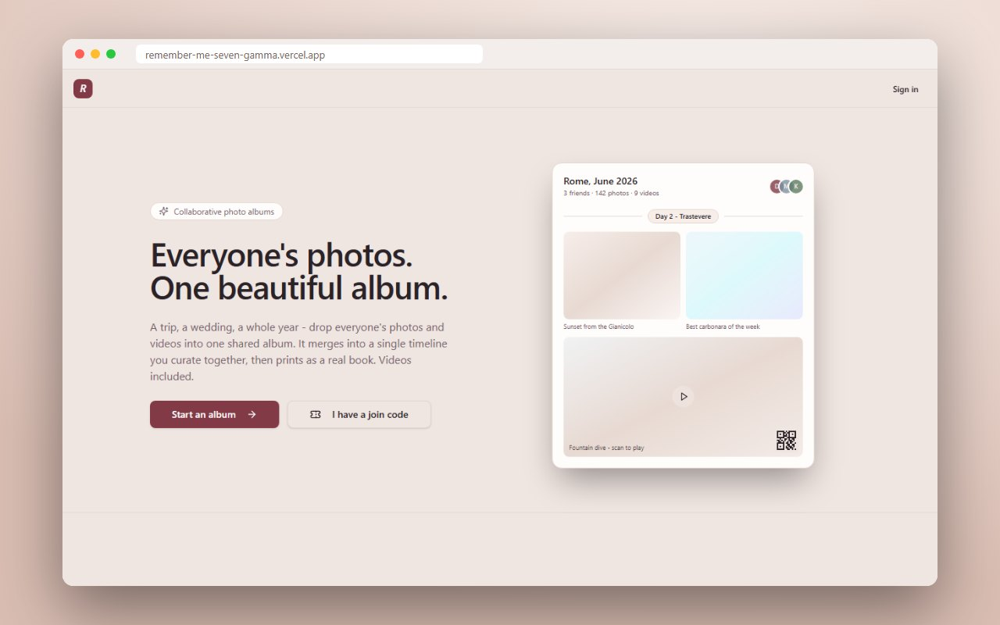
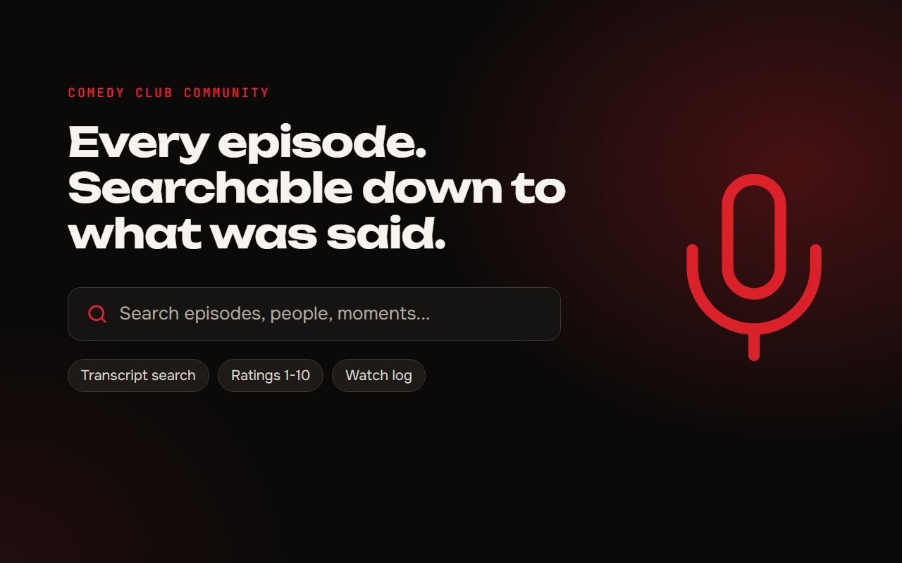
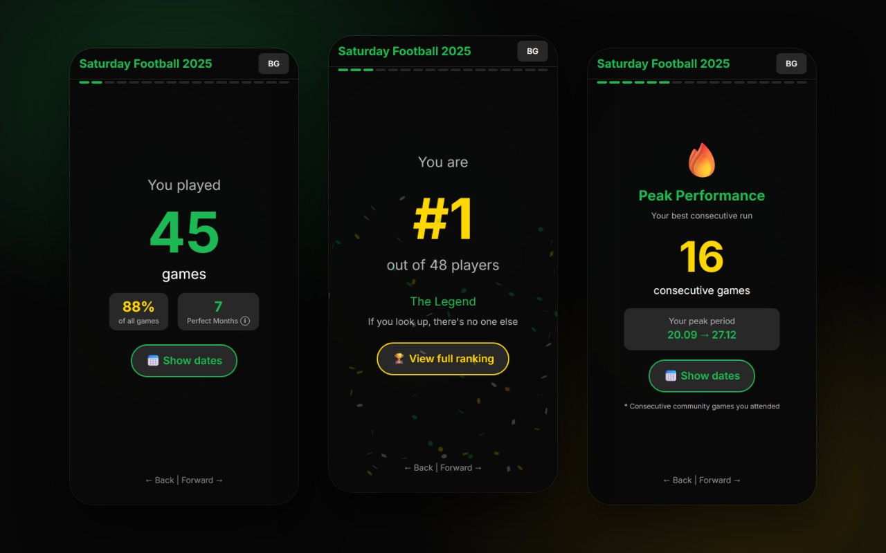

  

 

  

<h2 align="center">Things I've built</h2>

<table>
  <tr>
    <td colspan="2">
      
      <h3>Roomie</h3>
      AI interior designer. Photo of your room in, photoreal redesigns with real furniture from Bulgarian shops out, inside a hard budget.
       Crossroads AI Hackathon · Oct 2026 · private repo
    </td>
  </tr>
  <tr>
    <td width="50%" valign="top">
      
      <h3><a href="https://tifomaker.com">TifoMaker</a></h3>
      Design stadium choreographies. Build a 3D model of the stadium, paint the tifo on it, export seat-by-seat instructions as a PDF.
    </td>
    <td width="50%" valign="top">
      
      <h3><a href="https://remember-me-seven-gamma.vercel.app">Remember Me</a></h3>
      Shared trip albums. Friends drop in photos and videos, it merges them into one timeline and turns it into a printable book where videos become QR codes.
    </td>
  </tr>
  <tr>
    <td width="50%" valign="top">
      
      <h3><a href="https://comedycommunity.club">Comedy Club Community</a></h3>
      Every episode of a group of Bulgarian YouTube podcasts in one place, searchable down to what was said.
    </td>
    <td width="50%" valign="top">
      
      <h3><a href="https://github.com/TheHero9/SubotnoFutbolche">Football Wrapped</a></h3>
      Spotify Wrapped for my Saturday football group. 48 players, streaks, ranks, a quiz and the teammates you really play with.
    </td>
  </tr>
</table>

  Also: <a href="https://workouts-zh8n.vercel.app"><b>Workouts</b></a>, log workouts fast, track PRs, get feedback from an AI coach.

 

  

