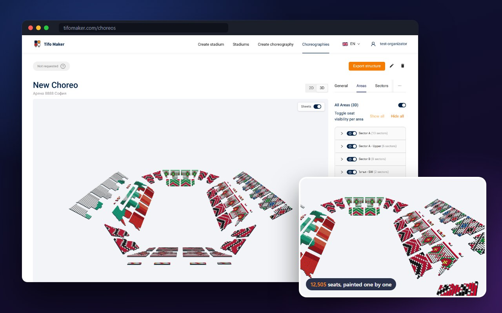
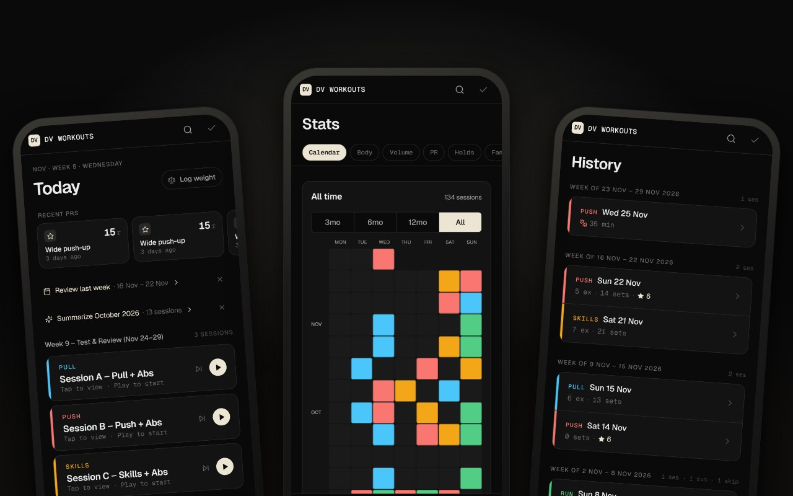
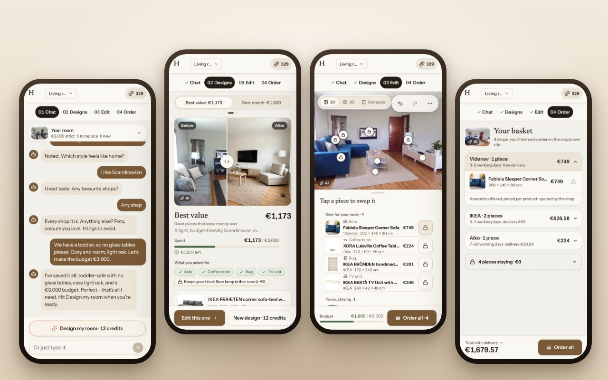
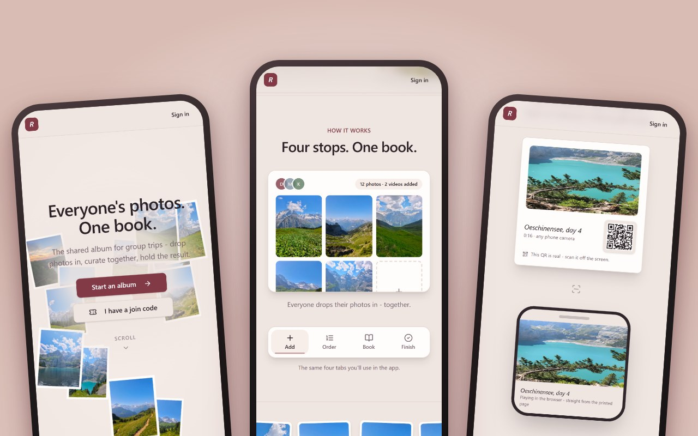
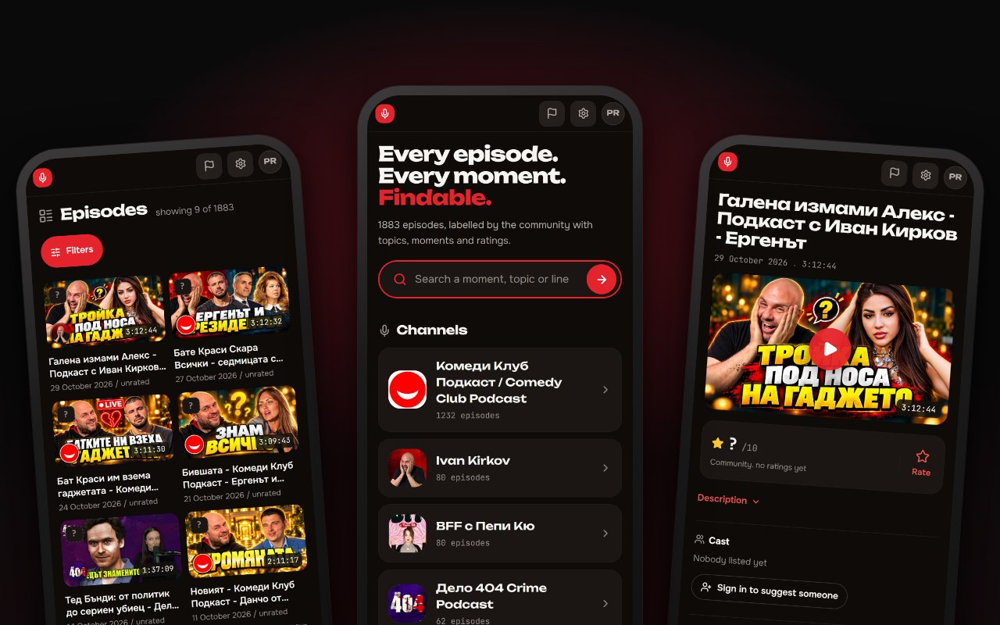
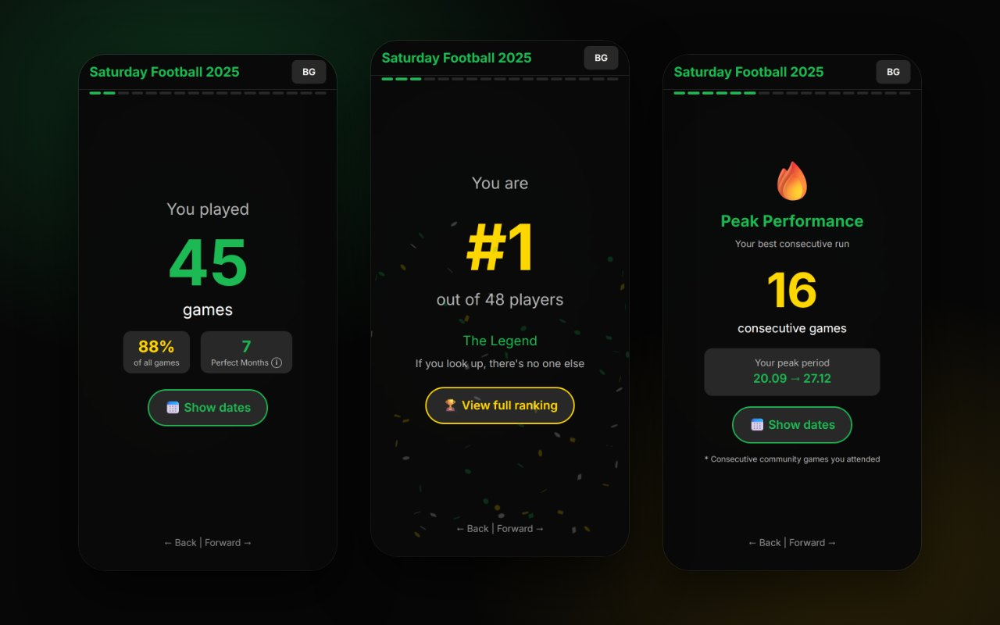

  

 

  

<h2 align="center">Things I've built</h2>

<table>
  <tr>
    <td>
      
      <h3><a href="https://tifomaker.com">TifoMaker</a></h3>
      Design stadium choreographies. Build a 3D model of the stadium, paint the tifo on it, export seat-by-seat instructions as a PDF.
    </td>
  </tr>
  <tr>
    <td>
      
      <h3><a href="https://workouts-zh8n.vercel.app">Workouts</a></h3>
      My training log, built for the gym floor. Log sets in seconds, even offline, track PRs, follow running plans and get feedback from an AI coach.
    </td>
  </tr>
  <tr>
    <td>
      
      <h3><a href="https://homesay.ai">Homesay</a></h3>
      Snap one photo of your room. Homesay redesigns it with real furniture from Bulgarian shops, checked to fit your walls and kept inside your budget.
       Born at the Crossroads AI Hackathon · Oct 2026 · live at <a href="https://homesay.ai">homesay.ai</a>
    </td>
  </tr>
  <tr>
    <td>
      
      <h3><a href="https://remember-me-seven-gamma.vercel.app">Remember Me</a></h3>
      Shared trip albums. Friends drop in photos and videos, it merges them into one timeline and turns it into a printable book where videos become QR codes.
    </td>
  </tr>
  <tr>
    <td>
      
      <h3><a href="https://comedycommunity.club">Comedy Club Community</a></h3>
      Every episode of a group of Bulgarian YouTube podcasts in one place, searchable down to what was said.
    </td>
  </tr>
  <tr>
    <td>
      
      <h3><a href="https://github.com/TheHero9/SubotnoFutbolche">Football Wrapped</a></h3>
      Spotify Wrapped for my Saturday football group. 48 players, streaks, ranks, a quiz and the teammates you really play with.
    </td>
  </tr>
</table>

 

  

